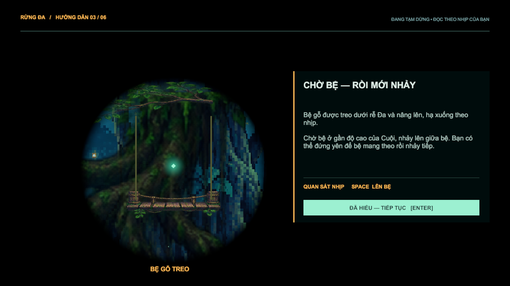

# Kiểm tra bản Refined — 18/11/2026

Build Windows x64, Unity 6000.3.16f1, Mono, URP 2D: **Succeeded, 0 errors, 0 warnings**. Bản bàn giao: `Builds/Windows-Refined/Cuoi.exe`.

## Kết quả trên build cuối

| Bộ kiểm tra | Kết quả | Bằng chứng |
|---|---|---|
| Gameplay nền tảng | 18/18 đạt | [playtest-results.json](Refined/playtest-results.json) |
| Vật lý bệ, coyote time, bóng tối, gió, quái | 18/18 đạt | [polish-results.json](Refined/polish-results.json) |
| Tutorial, idle, tiếp đất, biên trái | 22/22 đạt | [revision-results.json](Refined/revision-results.json) |
| Đi từ đầu tới mảnh trăng | Hoàn thành, 0 lần chết, đủ 6 tutorial | [route-results.json](Refined/route-results.json) |

Cả bốn tiến trình kiểm thử thoát mã 0. Lượt route dùng điều khiển bình thường, không teleport/bất tử: **58.42 giây gameplay**, 37 lần nhảy, 6 lần bừng sáng, qua đủ 5 checkpoint. Thời gian đọc tutorial không tính vào đồng hồ. Bot biết sẵn đường nên kết quả này không đại diện thời lượng lần chơi đầu của người thật.

## Những điểm đã xác nhận

- Tutorial tự mở tại vùng an toàn; player, quái, bệ, timer và sát thương dừng khi đọc. Enter qua Input System đóng bài và không gây nhảy ngoài ý muốn. Nút xác nhận bị khóa lúc mới mở; đủ sáu đối tượng nằm trong vùng focus. Chết không lặp bài đã đọc; Home/restart trả trạng thái bình thường.
- Idle trong 2.5 giây: cùng pose, dịch chuyển vật lý **0.00000**, dao động vị trí chân **0.00000**. Nhả hướng dừng sau khoảng **0.124 unit**. Sprite chân hạ **0.085 unit** so với collider.
- Giữ trái 2 giây: X nhỏ nhất **1.250**, không mất máu và không hồi sinh. Giới hạn được áp dụng trước bước di chuyển, tránh kéo nhân vật qua lại sau khi vượt biên.
- Đứng trên bệ qua hai chu kỳ: **0 frame sai grounded/jump animation**, khoảng cách chân với mặt bệ lớn nhất **0.007 unit**. Nhảy từ bệ đang lên và đang xuống đều đáp lại đúng.
- Không spawn thùng/bàn đạp. Còn hai bệ nâng, cả hai có dây treo và điểm neo. Coyote time 0.10s nhận input trong cửa sổ, từ chối sau cửa sổ và không tạo nhảy đôi.

## Kiểm tra hình ảnh và giới hạn

Ảnh trong thư mục [Refined](Refined/) được render từ camera + UI thực của player Windows, gồm sáu bài tutorial, chân trên rêu, biên trái, vùng tối và các checkpoint. Đã xem các ảnh để kiểm tra bố cục chữ, spotlight, dây treo, tiếp đất và vị trí đá/rễ ở đầu màn.

Kiểm tra nút bằng chuột và cảm giác điều khiển trực tiếp trên desktop chưa hoàn tất: Windows đang khóa. Kiểm thử tự động đã kiểm tra Enter qua Input System; đây không phải bằng chứng click chuột trên cửa sổ thật. Không có managed exception hoặc shader compilation error trong bốn log kiểm thử; có cảnh báo Curl/TLS của môi trường Unity.

Các báo cáo `POLISH_VERIFICATION.md` và `VERIFICATION.md` giữ lại kết quả của phiên bản trước. Log/JSON/ảnh của bản mới nằm riêng trong `QA/Refined`; checksum nguồn đã đối chiếu với project build nằm ở `Refined/source-sha256.csv`.
